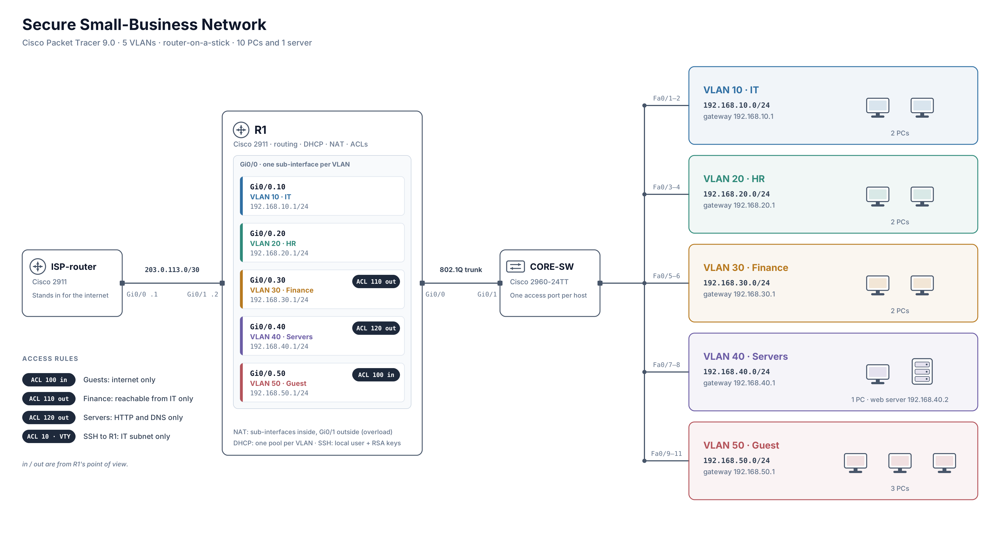

# Secure Small-Business Network in Cisco Packet Tracer

**English** | [Français](README_FR.md)

A small office network with five VLANs, built in Cisco Packet Tracer 9.0. One router handles routing between the VLANs, DHCP and NAT, and a few ACLs decide who can talk to whom. I built it to practise network segmentation and to end up with something I can test, document and explain.



## Devices

| Device | Model | Role |
|---|---|---|
| R1 | Cisco 2911 | Routing between VLANs (router-on-a-stick), DHCP, NAT, ACLs |
| CORE-SW | Cisco 2960-24TT | Switching, one access port per host, trunk to R1 |
| ISP-router | Cisco 2911 | Stands in for the internet (203.0.113.0/30) |
| 10 PCs, 1 server | PC-PT, Server-PT | End devices. The server runs HTTP and sits in VLAN 40 |

R1 `Gi0/0` goes to CORE-SW `Gi0/1` as an 802.1Q trunk. R1 `Gi0/1` (203.0.113.2/30) goes to the ISP router (203.0.113.1/30). Each VLAN has its own sub-interface on R1 and its own DHCP pool.

## Addressing

| VLAN | Name | Subnet | Gateway | Hosts |
|---|---|---|---|---|
| 10 | IT | 192.168.10.0/24 | 192.168.10.1 | 2 PCs |
| 20 | HR | 192.168.20.0/24 | 192.168.20.1 | 2 PCs |
| 30 | Finance | 192.168.30.0/24 | 192.168.30.1 | 2 PCs |
| 40 | Servers | 192.168.40.0/24 | 192.168.40.1 | 1 PC, 1 web server (192.168.40.2) |
| 50 | Guest | 192.168.50.0/24 | 192.168.50.1 | 3 PCs |

## What the rules do

- Guests can reach the internet but none of the internal networks (ACL 100, inbound on `Gi0/0.50`).
- Finance only accepts traffic coming from IT (ACL 110, outbound on `Gi0/0.30`).
- The server VLAN only accepts web (TCP 80) and DNS (UDP 53) (ACL 120, outbound on `Gi0/0.40`).
- Only the IT subnet can open an SSH session to R1 (ACL 10 used as `access-class` on the VTY lines, with a local user and RSA keys).

The reasoning behind where each rule sits is in [docs/design-notes.md](docs/design-notes.md).

## Testing

I ran 10 tests covering every rule, plus DHCP. All of them gave the expected result. For the blocked cases I also checked the ACL hit counters on R1, because a failed ping on its own doesn't prove which rule dropped it. Commands, results and screenshots are in [docs/test-plan.md](docs/test-plan.md).

## Problems I ran into

- I configured the VLAN 40 sub-interface and ACL 120 on the ISP router instead of R1, and had to remove them.
- SSH would not work at first: the router had a local user but no domain name and no RSA keys.
- The RSA key command was refused while the hostname was still `Router`.
- I had put `ip nat inside` on the physical interface, but the traffic arrives through the sub-interfaces.

The details and the commands are in the design notes.

## What I learned

ACLs don't track connections, and `in` and `out` are always from the router's point of view, so a rule can look right and still be in the wrong place. Most of my mistakes were small ones: configuring the wrong device, or a command on the wrong interface. Reading the running config before testing would have caught all of them. I also stopped trusting a ping that fails on its own. A rule counts as proven once the hit counter on the deny line goes up.

## What is missing

- Switch management is not configured: no management IP and no local user on CORE-SW, so it cannot be reached over SSH.
- No port security, and the unused switch ports are not shut down.
- One switch and one uplink, so there is no redundancy.
- The address of the web server (192.168.40.2) is not excluded from the VLAN 40 DHCP pool.
- The "internet" is a single router, so only reachability is tested.
- Switch management is not configured: CORE-SW has no management IP, no local user and no password, so it cannot be reached over SSH. The exported `core-switch.cfg` still contains an unused `access-list 10` and VTY lines with `access-class` and `transport input ssh`; they are leftovers and do not provide any protection.

## Repository

```
configs/        Running configs of the three devices (password hash removed)
docs/           Design notes and test plan (English and French)
screenshots/    Test evidence and incident screenshots
lab/ topology.png
lab/ secure-network.pkt
```

## Tools

Cisco Packet Tracer 9.0 and the IOS command line. I used an AI assistant as a tutor and to review my configs and documentation; the lab itself was built and tested by me.
