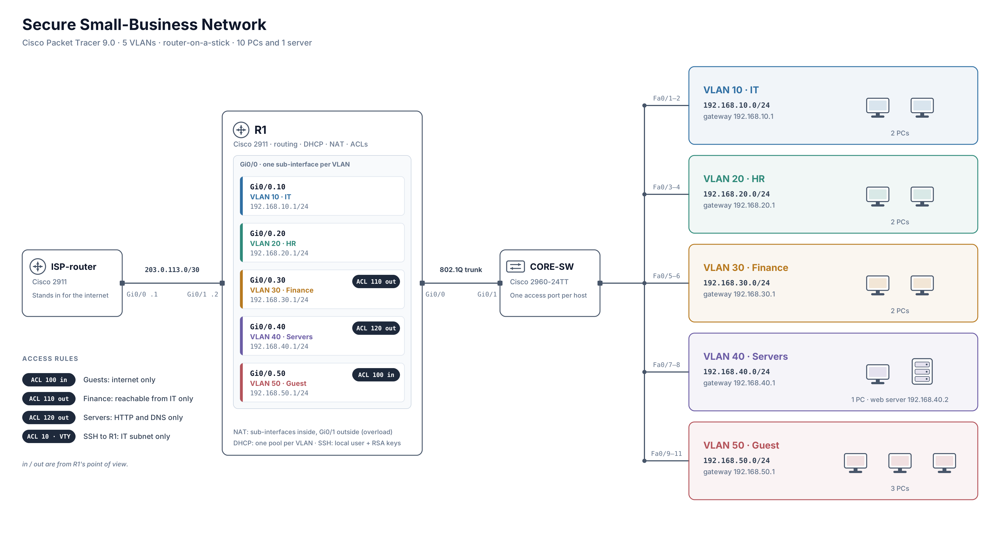

# Réseau de petite entreprise sécurisé sur Cisco Packet Tracer

[English](README.md) | **Français**

Un petit réseau de bureau avec cinq VLAN, construit sur Cisco Packet Tracer 9.0. Un seul routeur s'occupe du routage entre les VLAN, du DHCP et du NAT, et quelques ACL décident qui peut parler à qui. Je l'ai fait pour m'entraîner à la segmentation réseau et pour avoir un projet concret que je peux tester, documenter et expliquer.



## Équipements

| Équipement | Modèle | Rôle |
|---|---|---|
| R1 | Cisco 2911 | Routage inter-VLAN (router-on-a-stick), DHCP, NAT, ACL |
| CORE-SW | Cisco 2960-24TT | Commutation, un port d'accès par hôte, trunk vers R1 |
| ISP-router | Cisco 2911 | Simule Internet (203.0.113.0/30) |
| 10 PC, 1 serveur | PC-PT, Server-PT | Terminaux. Le serveur héberge un service HTTP dans le VLAN 40 |

Le port `Gi0/0` de R1 est relié à `Gi0/1` de CORE-SW en trunk 802.1Q. Le port `Gi0/1` de R1 (203.0.113.2/30) est relié au routeur ISP (203.0.113.1/30). Chaque VLAN a sa propre sous-interface sur R1 et son propre pool DHCP.

## Adressage

| VLAN | Nom | Sous-réseau | Passerelle | Hôtes |
|---|---|---|---|---|
| 10 | IT | 192.168.10.0/24 | 192.168.10.1 | 2 PC |
| 20 | RH | 192.168.20.0/24 | 192.168.20.1 | 2 PC |
| 30 | Finance | 192.168.30.0/24 | 192.168.30.1 | 2 PC |
| 40 | Serveurs | 192.168.40.0/24 | 192.168.40.1 | 1 PC, 1 serveur web (192.168.40.2) |
| 50 | Invités | 192.168.50.0/24 | 192.168.50.1 | 3 PC |

## Ce que font les règles

- Les invités peuvent accéder à Internet mais à aucun réseau interne (ACL 100, en entrée sur `Gi0/0.50`).
- Le VLAN Finance n'accepte que le trafic venant d'IT (ACL 110, en sortie sur `Gi0/0.30`).
- Le VLAN Serveurs n'accepte que le web (TCP 80) et le DNS (UDP 53) (ACL 120, en sortie sur `Gi0/0.40`).
- Seul le sous-réseau IT peut ouvrir une session SSH sur R1 (ACL 10 utilisée comme `access-class` sur les lignes VTY, avec un utilisateur local et des clés RSA).

Le raisonnement derrière l'emplacement de chaque règle est dans [docs/design-notes_FR.md](docs/design-notes_FR.md).

## Tests

J'ai fait 10 tests qui couvrent chaque règle, plus le DHCP. Tous ont donné le résultat attendu. Pour les cas bloqués, j'ai aussi regardé les compteurs de l'ACL sur R1, parce qu'un ping qui échoue ne prouve pas à lui seul quelle règle l'a bloqué. Les commandes, les résultats et les captures sont dans [docs/test-plan_FR.md](docs/test-plan_FR.md).

## Problèmes rencontrés

- J'ai configuré la sous-interface du VLAN 40 et l'ACL 120 sur le routeur ISP au lieu de R1, et j'ai dû les supprimer.
- Le SSH ne marchait pas au début : le routeur avait un utilisateur local mais ni nom de domaine ni clés RSA.
- La commande de génération des clés RSA était refusée tant que le nom d'hôte était `Router`.
- J'avais mis `ip nat inside` sur l'interface physique, alors que le trafic arrive par les sous-interfaces.

Les détails et les commandes sont dans les notes de conception.

## Ce que j'ai appris

Les ACL ne suivent pas les connexions, et `in` et `out` se lisent toujours du point de vue du routeur, donc une règle peut sembler juste et être au mauvais endroit. La plupart de mes erreurs étaient petites : le mauvais équipement, ou une commande sur la mauvaise interface. Relire la configuration en cours avant de tester les aurait toutes détectées. J'ai aussi arrêté de me fier à un ping qui échoue tout seul. Une règle est prouvée quand le compteur de la ligne deny augmente.

## Ce qui manque

- La gestion du switch n'est pas configurée : pas d'IP de management ni d'utilisateur local sur CORE-SW, donc il n'est pas joignable en SSH.
- Pas de port security, et les ports inutilisés du switch ne sont pas désactivés.
- Un seul switch et un seul lien montant, donc aucune redondance.
- L'adresse du serveur web (192.168.40.2) n'est pas exclue du pool DHCP du VLAN 40.
- « Internet » se résume à un routeur, donc seule l'accessibilité est testée.

## Contenu du dépôt

```
configs/        Configurations des trois équipements (hash du mot de passe retiré)
docs/           Notes de conception et plan de test (anglais et français)
screenshots/    Captures des tests et des incidents
lab/ topology.png
lab/ secure-network.pkt
```

## Outils

Cisco Packet Tracer 9.0 et la ligne de commande IOS. J'ai utilisé un assistant IA comme tuteur et pour relire mes configurations et ma documentation ; le lab lui-même a été construit et testé par moi.
